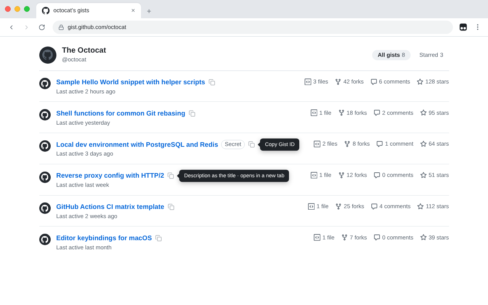
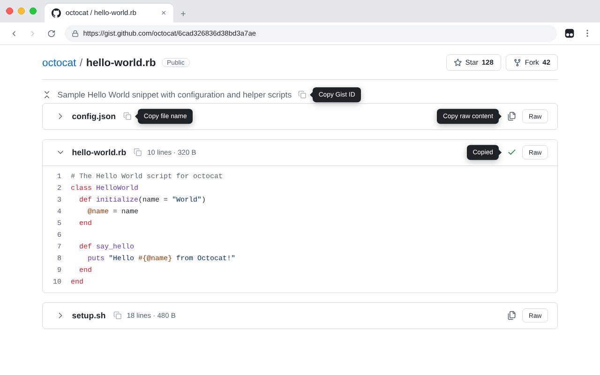
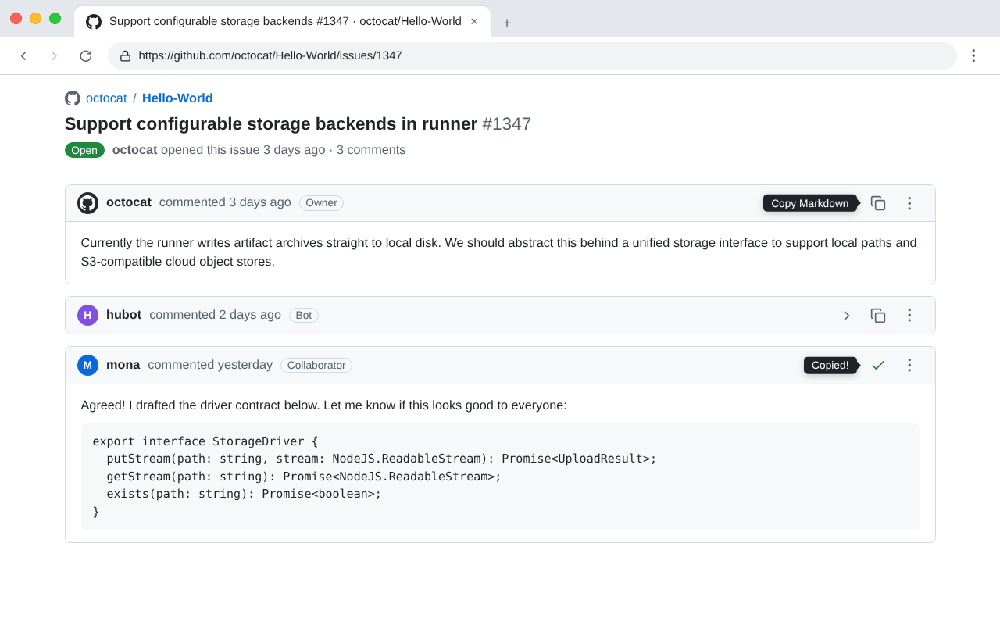

# GitHub & Gist: Collapse & Copy

让 Gist 和 GitHub 评论更易浏览，并能一键复制原文。

## 功能

- **Gist 列表**：隐藏代码预览，列表更紧凑；标题旁一键复制 Gist ID
- **Gist 详情页**：文件可单独折叠，也可一键全部折叠或展开；可在 Tampermonkey 菜单中开启 **Collapse files by default**，打开 Gist 时文件默认全部折叠；一键复制文件的 Raw 内容；描述旁一键复制 Gist ID，文件名旁一键复制文件名
- **仓库页**：仓库名称右侧一键复制 `owner/repo`
- **Issue / PR / Discussion 评论**：评论可折叠；一键复制评论的 Markdown 原文

## GitHub Token（可选）

复制评论原文需要调用 GitHub 接口。未设置 Token 时可以使用，但容易触发频率限制；私有仓库与 Discussion 必须设置。

1. 在 GitHub 创建 Personal Access Token；私有仓库需要 `repo` 权限。
2. Tampermonkey 菜单中选择 **Set GitHub token**，粘贴 Token；留空即清除。

## 截图

