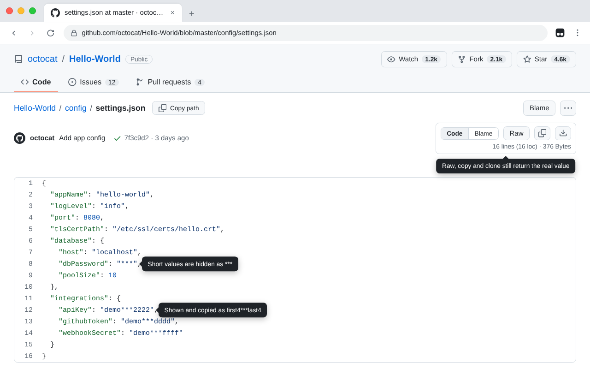

# GitHub & Gist: Mask Secrets

在线会议共享屏幕、录屏、截图，或用鼠标选中代码复制时，避免自己仓库和 Gist 里的 Token、密码等凭据被不小心泄露。

- 生效范围：默认为所有 GitHub 仓库与 Gist，包括文件内容、提交差异、README 与评论中的代码块
- 键名含 `TOKEN`、`KEY`、`SECRET`、`PASSWORD`、`CREDENTIAL` 等词的值，显示为「前 4 位 + `***` + 后 4 位」，较短的值整体显示为 `***`
- 用鼠标选中复制时，剪贴板里同样是遮盖后的值
- 需要真值时，使用 Raw 链接、复制按钮、下载或克隆

## 只遮盖指定账号（可选）

默认全部遮盖，无需设置。只想遮盖部分账号或组织时：

1. Tampermonkey 菜单中选择 **Set accounts to mask**。
2. 输入账号或组织名，多个用逗号或空格分隔；留空即恢复全部遮盖。

限定后，其他账号的页面保持原样：代码立即显示，也不会误遮。

遮盖不等于撤销泄露。凭据一旦以明文公开过，应当轮换。
