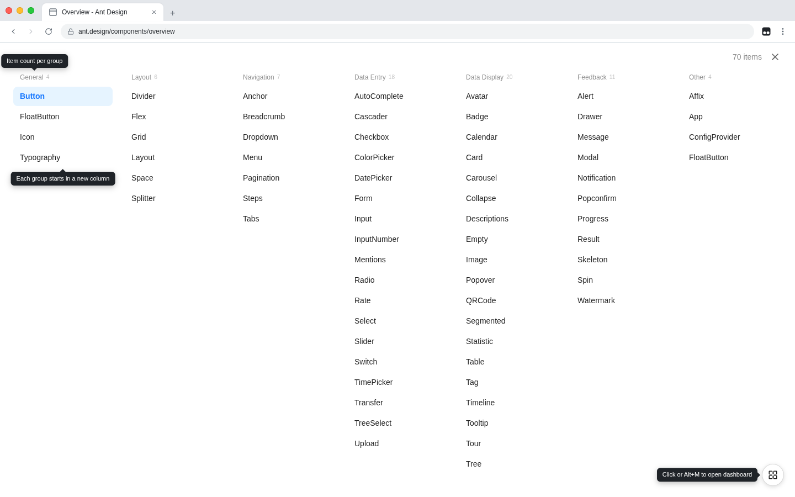
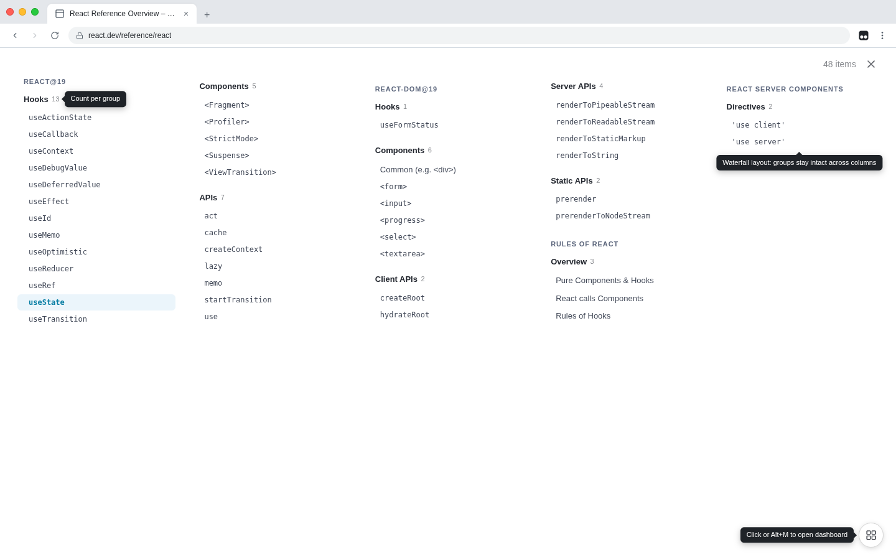

# Nav Dashboard

技术文档网站的左侧导航分成一组组，需要上下滚动才能看全。这个脚本打开一个全屏看板，把所有分组横向铺开，对整个技术栈一览无余。

- 生效页面：
  - Ant Design（含 2.x 至 5.x 历史版本与国内镜像）、Ant Design Vue
  - Element Plus、Element UI
  - TDesign（含 React、Vue、移动端、小程序等各版本）、DevUI（设计规范与组件文档）
  - Arco Design（React、Vue、移动端与设计规范）
  - React API 与学习文档、Vue 3 API 与指南、Vue 2 API、Vant、AngularJS
- 点击右下角的按钮，或按 Alt+M（macOS 为 Option+M）打开看板；再按一次、点击右上角的关闭图标或按 Esc 关闭
- 看板沿用网站原有的导航样式，只是铺满全屏、按分组排成多列，有两种布局：
  - 分列：每个分组从新的一列开始，一列放不下时接续到下一列，横向滚动
  - 瀑布流：按屏幕宽度分成若干列，分组依次往下排、不拆开，竖向滚动；适合分组多而短的网站，例如 Vue 3 API
- 每个分组标题后标出项数，右上角显示总数
- 点击任意项即跳转，Ctrl/⌘+点击在新标签页打开
- 在网站内切换栏目（例如 Ant Design 的「设计」「研发」「组件」）后，看板随之显示当前栏目的导航

## 支持新的网站

在脚本中加一行 `@match`，再在 `SITES` 中加一项，填写导航容器、分组、分组标题、导航项四个 CSS 选择器即可，写法见 `SITES` 上方的注释。默认布局可在 `LAYOUT` 中修改，也可为单个网站指定；快捷键可在 `SHORTCUT` 中修改。
